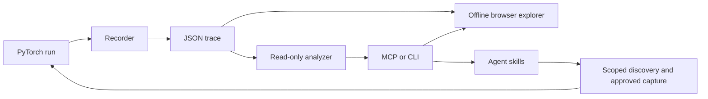
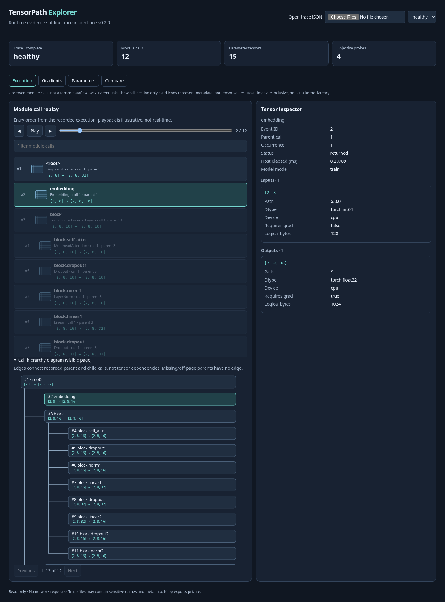

# TensorPath

**Stop guessing what your model did. Inspect what actually ran.**

  

TensorPath is an evidence-first PyTorch inspection toolkit for AI agents. Record a model run once, inspect its tensor shapes and gradients, compare runs, and verify a diagnosis without exposing raw activations or loading the model into your agent's process.

> **Preview:** CPU behavior and local setup tested; real MCP transport and other platforms require validation. See [VERIFICATION.md](VERIFICATION.md).

## Why TensorPath?

Static code inspection cannot tell you which modules executed, whether a tensor required gradients at runtime, or which objectives were connected to a particular embedding. TensorPath separates observed evidence from interpretation.



- **Explore:** replay recorded calls, inspect tensor metadata, review gradients and compare runs in an offline browser.
- **Observe:** module calls, nested tensor metadata, shared-module aliases, parameter snapshots and optimizer membership.
- **Probe:** per-objective gradient norms, zero versus unused, cosine similarity on explicit targets.
- **Compare:** exact differences between two trace files, with paginated results.
- **Diagnose:** evidence-backed observations, not automatic root-cause claims.
- **Verify:** a portable skill workflow that requires controlled reproduction before declaring a fix.
- **Local-first:** no hosted service, no raw tensor payload, no PyTorch dependency in the analyzer or MCP process.

## Agent-first quick start

**Install once, ask in natural language.** Unpack this release, enter the repository root, and use a dedicated Python environment (3.10+). Hermes must already be installed. The analyzer does not need PyTorch.

```sh
python3 -m venv .venv
source .venv/bin/activate
python -m pip install -e '.[mcp,setup]'
tensorpath --root examples/sample_traces setup --project .
# Review the preview, then stop Hermes and apply:
tensorpath --root examples/sample_traces setup --project . --apply
tensorpath --root examples/sample_traces doctor --protocol
```

The setup command installs ten skills and registers the local stdio server, including a scoped AST project inventory and HTML report creation. It preserves unrelated YAML entries and backs up changed configuration and replaced skill directories. If upgrading conflicting TensorPath entries, preview with `--replace`, then apply with `--replace --apply`. The default report directory is `<trace root>/reports`; use `--reports` to select a private alternative. Paths are resolved at setup time. Restart Hermes. Then simply ask:

> Use TensorPath to compare healthy and detached, explain the observed gradient difference, and create an interactive HTML report.

For your own project, use its absolute path as `--project` and a private trace directory as `--root`. If no trace exists, the skill helps prepare a minimal capture using the agent's existing terminal tool **after explicit approval**. It does not launch project code through MCP. No training, download, or optimizer update is required for a forward-only capture. The CLI is a fallback/debugging interface, not the normal user workflow.

## TensorPath Explorer — new in v0.2



Open a recorded trace, select a module call, replay its entry order, inspect input/output tensor metadata, and compare gradient or parameter observations. No model, PyTorch, Node.js, web server or network connection is required to view existing traces.

```sh
python -m pip install -e .
tensorpath --root examples/sample_traces visualize healthy --include detached --output explorer.html --open
```

Open additional JSON files with the file picker, or repeat `--include` at export time. Existing output files are not overwritten. This is a **module-call hierarchy**, not a tensor dependency graph. Playback is illustrative, not real-time; actual tensor values and exact backward edges are not collected. See [Explorer guide](docs/explorer.md).

## Quick start

Clone or unpack this repository and enter its root. Python 3.10+; use an isolated environment. On macOS/Linux:

```sh
python3 -m venv .venv
source .venv/bin/activate
python -m pip install -e '.[record,mcp,test]'
python examples/tiny_transformer.py --root traces
tensorpath --root traces diagnose detached
```

On Windows PowerShell activate with `.venv\Scripts\Activate.ps1` (or use the environment's `python.exe` directly). Install a PyTorch build appropriate for your accelerator following [official guidance](https://pytorch.org/get-started/locally/); the generic extra is not a CUDA provisioning script. If PyTorch already exists in your training environment, install `pip install -e .` there instead.

Expected observation from the included example: `objective_grad_unused` for the embedding in the intentionally detached run. This is evidence of graph disconnection for the selected objectives, not a general detector of all training bugs.

```sh
tensorpath --root traces gradients healthy --target embedding
tensorpath --root traces compare healthy detached --section gradients
tensorpath --root traces forward healthy --limit 5
```

Each run needs a unique trace ID; rerunning examples in the same directory intentionally refuses to overwrite existing traces. Use a fresh directory.

## Try the analyzer without PyTorch

The bundled synthetic traces are actual outputs from the included examples, not hand-written data. To inspect them using only Python:

```sh
python -m pip install -e .
tensorpath --root examples/sample_traces compare healthy detached --section gradients
```

For an MCP-only environment, install `.[mcp]` instead.

## Instrument your own model

```python
from tensorpath import Recorder

optimizer.zero_grad(set_to_none=True)
with Recorder(model, "traces", "run_001") as tp:
    logits = model(inputs)
    loss = criterion(logits, labels)
    tp.probe_gradients({"task": loss}, {"head": model.head.weight})
    loss.backward()
    tp.snapshot_parameters(optimizer, gradient_label="after_backward_before_step_unscaled")
optimizer.step()
```

Adapt `model.head.weight` to an actual tensor in your model. For soft prompts or other external trainable leaf tensors, use `extra_targets={"BE": be}` in the snapshot. See [examples/multi_objective.py](examples/multi_objective.py) for a frozen-model CE/KD example. Pass unweighted losses if you want unweighted objective gradients. Probe before backward; it retains the graph and performs extra autograd work. Custom hooks can have side effects. Run on a debug batch, not every training step.

## Connect to other agents / manual configuration

Install `.[mcp]` in the analysis environment. Create private trace and report directories and optionally approve a project directory. For Hermes, the `setup` command above is recommended; equivalent manual configuration (merge, do not replace):

```yaml
mcp_servers:
  tensorpath:
    command: /absolute/path/.venv/bin/python
    args: ["-m", "tensorpath.server", "--root", "/absolute/traces", "--project", "/absolute/project", "--reports", "/absolute/reports"]
```

For other MCP clients, use the equivalent `mcpServers` JSON mapping as documented by that client. On Windows use the environment's `Scripts/python.exe`. Copy only the ten `skills/tensorpath*/` directories into the client's documented skills directory. Automatic setup currently targets Hermes only. The MCP client launches the server through stdio; no additional port or terminal. `--project` and `--reports` are optional, but their corresponding tools return a configuration error if omitted. No arbitrary execution endpoint exists. Skills are advisory, not a sandbox. See [security](docs/security.md).

For an approved forward-only capture in a separate PyTorch environment:

```python
from tensorpath import capture_forward
path = capture_forward(model, "/absolute/traces", args=(inputs,))
```

The helper does not update weights or change train/eval flags; model forward code itself can mutate state or perform I/O. Review trusted code and inputs first. For gradients, use the explicit Recorder example above.

## Tool surface

| Tool | Purpose |
|---|---|
| `list_traces` | Discover trace IDs |
| `inspect_model` | Modules or parameter snapshot |
| `trace_forward` | Nested module calls and observed input/output metadata |
| `analyze_gradients` | Per-objective stats, pairwise cosines, or parameter gradients |
| `diagnose` | Flag observations to investigate |
| `compare_traces` | Exact event, parameter, gradient, or cosine changes |
| `discover_project` | Static candidate inventory in configured project |
| `visualize_execution` | New uniquely named offline HTML in configured reports directory |

Analysis results are bounded and paginated; continue with `next_offset`. Discovery has scan limits; report generation writes only to the configured private directory. An oversized individual row is omitted and marked. See [docs/trace-format.md](docs/trace-format.md).

## Skills

| Skill | When to activate |
|---|---|
| `tensorpath` | Route an ambiguous model-debugging request |
| `tensorpath-discover-project` | Static discovery before execution |
| `tensorpath-record-execution` | Approved minimal recording plan |
| `tensorpath-visualize-execution` | Generate Explorer from existing trace |
| `tensorpath-inspect-model` | Trainability and optimizer membership |
| `tensorpath-trace-forward` | Shape/device/dtype questions |
| `tensorpath-trace-gradients` | Loss-specific and missing/zero gradients |
| `tensorpath-diagnose-training` | Root-cause investigation with rival hypotheses |
| `tensorpath-compare-executions` | Compare controlled runs |
| `tensorpath-verify-diagnosis` | Check fresh evidence before declaring a fix |

## Scope and limitations

Eager, single-threaded PyTorch `nn.Module` execution only. Hooks do not expose every functional operator, fused attention kernel, compiled graph, or distributed rank. Direct `.forward()` calls bypass normal module hooks. Host elapsed times are inclusive and not GPU kernel timing. Logical tensor bytes are not allocated GPU memory or peak memory. Shared module names are canonical aliases, not individual call-site identifiers. Caught recursive exceptions can make parent attribution ambiguous. Parameter snapshots reflect one explicitly chosen instant, not optimizer updates; scaled, accumulated, stale, or sparse gradients need separate interpretation. `probe_gradients` is opt-in and can be expensive. Quantized/sparse/meta and unusually nested objects may be unsupported or partially represented. An empty diagnostic report is not proof of correctness. External trace files are untrusted and not cryptographically authenticated. Use private local folders.

## Test and contribute

```sh
python -m pytest -q
```

Setup is preview-first; `--apply` changes local configuration, `--replace` replaces conflicting TensorPath entries with backups. Stop Hermes before applying. See [verification](VERIFICATION.md) for actual test coverage. CI is included for Linux, macOS, Windows and two Python versions, but has not run on GitHub yet. See [VERIFICATION.md](VERIFICATION.md) for executed tests versus planned tests. Korean Hermes instructions: [Quick start (한국어)](docs/QUICKSTART.ko.md). The [evaluation cases](docs/evaluation.md) describe how to assess skill behavior with a real model rather than treating unit tests as LLM benchmarks.

## Inspiration

Agent-first workflow inspired by [REA](https://github.com/morluto/rea) and [Hermes native MCP](https://github.com/NousResearch/hermes-agent/blob/main/website/docs/user-guide/features/mcp.md). Independent implementation inspired by [PyTorch hooks](https://docs.pytorch.org/docs/stable/generated/torch.nn.Module.html), [autograd](https://docs.pytorch.org/docs/stable/generated/torch.autograd.grad.html), [Torchinfo](https://github.com/TylerYep/torchinfo), [PyTorch Profiler](https://docs.pytorch.org/docs/stable/profiler.html), [Superpowers](https://github.com/obra/superpowers), [Agent Skills](https://agentskills.io/specification), and the [MCP Python SDK](https://github.com/modelcontextprotocol/python-sdk). No affiliation or code copied from these repositories.

MIT — see [LICENSE](LICENSE). Preview; do not rely on it as a complete training correctness or security proof.
